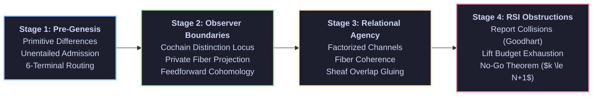

# Theory of Finite Relational Agency and Recursive Self-Modification

> **From Pre-Genesis to Observer Boundaries to Bounded Recursive Systems: A Constructive Mathematical Investigation into Finite Awareness, Agency, and Self-Improvement Limits**

---

## Overview

Cognitive science, artificial intelligence, and decision theory frequently rely on ambient continuum formulations: ungrounded scalar utility functions, unindexed omniscient observers ("the view from nowhere"), unbounded recursive self-improvement trajectories, and metaphysical postulates regarding consciousness.

This repository investigates foundational mathematical questions on discrete substrates:
1. **Can awareness and agency be constructed from the ground up on purely finite, discrete relational complexes without postulating unindexed internal observers?**
2. **What exact topological and combinatorial obstructions prevent infinite recursive self-improvement within a finite relational universe?**

Rather than presuming continuous optimization or metaphysical qualia, this project develops a step-by-step mathematical trajectory from first principles:
1. **Pre-Genesis & Relational Substrates**: Primitive distinctions, marks, and zero-relation preservation without an ambient metric container or external authority.
2. **Awareness & Observer Boundaries**: Minimal cochain boundary registration ($d_\Omega c \ne 0$), private internal fibers versus public boundary projections, and exact two-state estimation bounds under observation channels.
3. **Relational Alignment & Agency**: Boundary-factorized communicative channels, communicative fiber coherence, and sheaf overlap compatibility across discrete observer panels.
4. **Recursive Self-Modification & Obstruction Calculus**: Formalizing the bounded no-go theorem for recursive self-improvement (RSI) under finite report capacity and licensed lift budgets.

---

## Derivation Arc



### 1. Pre-Genesis: Operational Grammar & Zero-Containers
- Operating without an ambient background metric container $(M, g_{\mu\nu})$ prior to relational distinction.
- Six-constructor operational grammar: $\mathsf{mention}, \mathsf{supply}, \mathsf{designate}, \mathsf{admit}, \mathsf{retain}, \mathsf{operate}$.
- Enforcing unentailed admission: mentioning or supplying a candidate state carries zero authorization standing.
- Disjoint six-terminal epistemic routing ($\mathbb{T}_{\mathrm{status}} = \{\mathsf{evidence\_only}, \mathsf{authorized}, \mathsf{rejected}, \mathsf{unresolved}, \mathsf{refused}, \mathsf{not\_admitted}\}$).

### 2. Observer Boundaries & Minimal Awareness Loci
- Formulating awareness constructively as an observer cochain locus $\mathcal{A}_\Omega = (\mathcal{S}, d_\Omega, P_{\mathrm{obs}})$ registering non-zero coboundary distinctions ($d_\Omega c \ne 0$).
- Boundary-projected observer states $(\pi_O, Y_O, X_O)$ partitioning private internal states from public boundary observables.
- Establishing the two-state estimation bound under single observations: equal public boundaries yield identical deterministic decoders, forcing private fiber estimation errors to satisfy the triangle inequality.
- Demarcating feedforward architectures: vanishing 1-cochain cohomology ($H^1 = 0$) during forward passes and absence of autopoietic homeostatic closure.

### 3. Relational Agency & Channel Factorization
- Grounding alignment in boundary-factorized channels $\tau = \iota \circ \kappa \circ \pi_A$ rather than scalar utility maximization over external benchmarks.
- Preserving zero-relations, communicative private fibers, and intersubjective sheaf overlap compatibility ($\Phi_1([\delta]) = 0$).
- Formulating the Three-Axis Self-Grounding Regress: ungrounded internal processes cannot self-certify semantic truth across precondition collapse, meta-carrier tower regress, and gauge relabeling blindness.

### 4. Recursive Self-Modification & The Bounded No-Go Theorem
- Mechanizing the bounded RSI no-go theorem: in any finite relational universe $\mathcal{U}$ with report capacity $N = |C_{\mathrm{rep}}|$, no self-modifying trajectory $\mathcal{M}_{k+1} = \Phi(\mathcal{M}_k)$ can sustain irreflexive, transitive dominance grounded in the report carrier.
- Pinpointing the three interacting obstruction mechanisms terminating self-modification at step $k \le N + 1$:
  1. **Metric Collapse & Goodhart Decoupling**: Independent Signal 2 verification cannot be supplied by internal self-critique ($\neg \mathsf{IsIndependentVerifier}(g, g)$).
  2. **Lift-Budget Monotonicity**: Internal proposals carry zero authority; expanding the relational carrier strictly consumes a finite licensed lift budget ($B_{k+1} < B_k$). At $B_k = 0$, carrier expansion terminates.
  3. **Sheaf Overlap Gluing Refusal**: Transformed states incur non-zero triangle coboundary defects ($\Phi_1([\delta]) > 0$), triggering verification gate rejection.

---

## Architectural Principles

- **Constructive and Exact**: Replaces float-based heuristic fitness with exact integer, rational, and combinatorial invariants over finite carrier graphs.
- **Fail-Closed Gate Verification**: Declarative prose and markdown specifications carry `AuthorityEffect: None`. Operational verification requires executing compiled test suites and producing immutable machine receipts.
- **Claim Hygiene & Negative Evidence**: Explicitly registers negative results, proof bounds, and counterexample witnesses alongside positive derivations.
- **Independent Two-Signal Governance**: Candidate modifications require separate generation (Signal 1) and independent host-witness verification (Signal 2) to prevent self-authorizing loops.

---

## Core Program Census

This repository synthesizes foundational research monographs and formal proof packages:

| Program / Area | Source Directory | Core Focus |
|---|---|---|
| **Mind & Observer Boundaries** | `coda_atlas/F004_papers/005_mind_and_consciousness/` | Cochain distinction loci, private fiber non-transmissibility bounds, and pseudoinverse operator merging. |
| **Recursive Self-Improvement** | `coda_atlas/F004_papers/012_rsi/` | Bounded RSI no-go theorem ($k \le N + 1$), two-signal epistemic independence, and lift-budget exhaustion. |

---

## Epistemic Boundary Envelope

In accordance with strict claim hygiene:

1. **What this repository supports:**
   - Formal, machine-checked theorems showing that infinite strict self-improvement under report-grounded dominance cannot be sustained on finite relational carriers with bounded lift budgets.
   - Exact mathematical bounds showing that private fiber coordinates cannot be reliably decoded from a single public boundary observation.
   - Executable verification of cochain boundary registrations and two-signal gate refusals.

2. **What this repository does not support:**
   - Does **not** claim to resolve the metaphysical hard problem of subjective qualia.
   - Does **not** claim that existing synthetic language models exhibit phenomenal consciousness.
   - Does **not** claim empirical results about continuous biological nervous systems.

3. **Narrowest defensible claim:**
   - Within a background-free finite relational system where evaluations factor through finite observer panels and report capacities, any self-modifying sequence claiming strict report-grounded improvement terminates within finite steps $k \le N + 1$.

4. **Next test needed:**
   - Multi-observation dynamic decoders over finite state histories to evaluate how memory depth impacts private fiber reconstruction bounds.

---

## Getting Started

### Prerequisites

- **Python 3.11+** for discrete transition harnesses and property tests.
- **Rust Toolchain** (latest stable) for exact rational certifiers and epistemic gate companions.
- **Lean 4** (`v4.14.0+`) for formal interactive theorem verification.

### Running the Verification Pipeline

```bash
# Execute Python property suites and transition harness tests
pytest -v

# Run sovereign Rust certifiers and exact gate engines
cargo test

# Check formal Lean 4 theorems (zero sorry, zero custom axioms)
lake build
```

---

## License

- **Documentation & Specifications**: Creative Commons Attribution 4.0 International ([CC-BY-4.0](https://creativecommons.org/licenses/by/4.0/)).
- **Code & Proof Kernels**: Apache-2.0 or PolyForm Noncommercial 1.0.0 (refer to individual package licenses).
